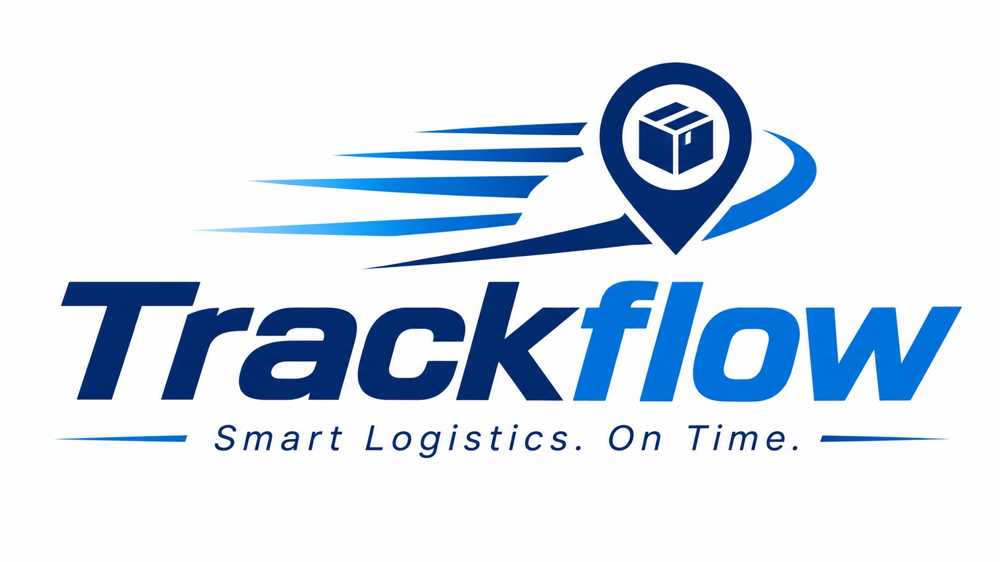

# 🎯 HERO SECTION - GUÍA DE REFERENCIA

## Última Actualización: 2026-11-14

---

## 📐 ESTRUCTURA VISUAL DEL HERO

### Desktop View (1920px)
```
┌─────────────────────────────────────────────────────────────────────┐
│  Logo: TrackFlow                                [Inicio] [Servicios] │
│                                          [Cobertura] [Contacto] [EN▼]│
├─────────────────────────────────────────────────────────────────────┤
│                                                                      │
│  Left Column (50%)           │        Right Column (50%)             │
│  ─────────────────────────   │        ─────────────────────────      │
│                              │                                       │
│  Logistics that scales       │                                       │
│  with your e-commerce        │                                       │
│  (Heading: text-6xl)         │        [Imagen Hero                   │
│                              │         Warehouse/Logistics]          │
│  Warehouse management...     │                                       │
│  (Subtitle: text-lg)         │                                       │
│                              │                                       │
│  [Request Information]       │                                       │
│  (Button: py-4 px-10)        │                                       │
│                              │                                       │
│                              │                                       │
│                              │                                       │
│                              │                                       │
│                              │                                       │
└─────────────────────────────────────────────────────────────────────┘
```

### Tablet View (768px)
```
┌─────────────────────────────────────────────┐
│  Logo: TrackFlow          [Menú☰]    [EN▼]  │
├─────────────────────────────────────────────┤
│                                             │
│  Logistics that scales                      │
│  with your e-commerce                       │
│  (Heading: text-5xl)                        │
│                                             │
│  Warehouse management, last-mile delivery   │
│  and reverse logistics...                   │
│  (Subtitle: text-base)                      │
│                                             │
│  [Request Information]                      │
│  (Button: py-3 px-8)                        │
│                                             │
├─────────────────────────────────────────────┤
│                                             │
│         [Imagen Hero - 100% ancho]          │
│         [Warehouse/Logistics]               │
│                                             │
│                                             │
└─────────────────────────────────────────────┘
```

### Mobile View (375px)
```
┌──────────────────────┐
│ T [Menú☰]     [EN▼]  │
├──────────────────────┤
│                      │
│  Logistics that      │
│  scales with your    │
│  e-commerce          │
│  (Heading: text-3xl) │
│                      │
│  Warehouse mgmt,     │
│  last-mile delivery  │
│  and reverse...      │
│  (Subtitle: text-sm) │
│                      │
│  [Request Inform.]   │
│  (Button: py-3 px-8) │
│                      │
├──────────────────────┤
│                      │
│    [Imagen Hero]     │
│  [Warehouse/Logistics]│
│                      │
│                      │
└──────────────────────┘
```

---

## 📝 CONTENIDO DEL HERO

### SECCIÓN: `<section id="home">`

#### Título Principal (H1)
```
Inglés:  "Logistics that scales with your e-commerce"
Español: "Logística que escala con tu e-commerce"

Atributos:
• id="hero-title"
• data-en="..." (para traducción)
• data-es="..." (para traducción)
• class="text-3xl sm:text-5xl lg:text-6xl font-bold..."
```

#### Subtítulo (Párrafo)
```
Inglés:
"Warehouse management, last-mile delivery and reverse logistics 
in the United States and Spain. Over 15 years helping fashion, 
electronics and cosmetics brands grow without worrying about operations."

Español:
"Gestión de almacenes, entregas de última milla y logística inversa 
en Estados Unidos y España. Más de 15 años ayudando a marcas de moda, 
electrónica y cosmética a crecer sin preocuparse por la operación."

Atributos:
• data-en="..." (para traducción)
• data-es="..." (para traducción)
• class="text-sm sm:text-base lg:text-lg text-gray-700..."
```

#### Call-to-Action Button
```
Inglés:  "Request Information"
Español: "Solicitar Información"

Atributos:
• href="#form" (enlaza a sección formulario)
• class="bg-primary-500 hover:bg-primary-600..."
• class="py-3 sm:py-4 px-8 sm:px-10" (tamaño prominente)
• aria-label="Go to contact form"
```

#### Imagen Hero
```

```

---

## 🎨 CLASES TAILWIND CSS

### Contenedor Principal (Section)
```css
class="grid grid-cols-1 lg:grid-cols-2 gap-6 sm:gap-8 lg:gap-12 
       items-center px-4 sm:px-6 lg:px-8 
       py-8 sm:py-12 lg:py-24 
       max-w-6xl mx-auto 
       min-h-[500px] sm:min-h-[600px]"
```

**Desglose:**
- `grid grid-cols-1 lg:grid-cols-2`: 1 columna móvil, 2 columnas desktop
- `gap-6 sm:gap-8 lg:gap-12`: Espaciado entre columnas (responsivo)
- `items-center`: Centrado vertical
- `px-4 sm:px-6 lg:px-8`: Padding horizontal (responsivo)
- `py-8 sm:py-12 lg:py-24`: Padding vertical (responsivo)
- `max-w-6xl mx-auto`: Ancho máximo y centrado
- `min-h-[500px] sm:min-h-[600px]`: Alto mínimo responsivo

### Contenedor de Texto (Div)
```css
class="flex flex-col justify-center order-2 lg:order-1"
```

**Desglose:**
- `flex flex-col`: Contenedor flexible, dirección columna
- `justify-center`: Centrado vertical
- `order-2 lg:order-1`: En móvil aparece debajo (order-2), en desktop arriba (order-1)

### Título Principal (H1)
```css
class="text-3xl sm:text-5xl lg:text-6xl 
       font-bold 
       leading-tight 
       mb-4 sm:mb-6 
       text-dark-900"
```

**Desglose:**
- `text-3xl sm:text-5xl lg:text-6xl`: 3xl móvil → 5xl tablet → 6xl desktop
- `font-bold`: Peso de fuente bold
- `leading-tight`: Altura de línea ajustada
- `mb-4 sm:mb-6`: Margen inferior responsivo
- `text-dark-900`: Color oscuro (#0a0e27)

### Subtítulo (Párrafo)
```css
class="text-sm sm:text-base lg:text-lg 
       text-gray-700 
       mb-6 sm:mb-8 
       leading-relaxed"
```

**Desglose:**
- `text-sm sm:text-base lg:text-lg`: Tamaño responsivo
- `text-gray-700`: Gris oscuro (mayor contraste)
- `mb-6 sm:mb-8`: Margen inferior responsivo
- `leading-relaxed`: Altura de línea cómoda para lectura

### Botón (Enlace)
```css
class="inline-block 
       bg-primary-500 hover:bg-primary-600 
       text-white 
       font-semibold 
       py-3 sm:py-4 px-8 sm:px-10 
       text-sm sm:text-base 
       rounded-lg 
       transition-all 
       hover:scale-105 
       hover:shadow-lg 
       transform hover:-translate-y-1 
       w-fit"
```

**Desglose:**
- `inline-block`: Ancho ajustado al contenido
- `bg-primary-500 hover:bg-primary-600`: Color y hover effect
- `text-white`: Texto blanco
- `font-semibold`: Peso semibold
- `py-3 sm:py-4 px-8 sm:px-10`: Padding responsivo (aumentado 50%)
- `rounded-lg`: Bordes redondeados
- `transition-all`: Animación suave
- `hover:scale-105 hover:shadow-lg hover:-translate-y-1`: Efectos hover interactivos
- `w-fit`: Ancho al contenido

### Contenedor de Imagen (Div)
```css
class="order-1 lg:order-2"
```

**Desglose:**
- `order-1 lg:order-2`: En móvil aparece arriba (order-1), en desktop abajo (order-2)

### Imagen
```css
class="w-full 
       h-auto 
       rounded-lg 
       shadow-xl"
```

**Desglose:**
- `w-full`: Ancho 100%
- `h-auto`: Alto automático (mantiene proporción)
- `rounded-lg`: Bordes redondeados
- `shadow-xl`: Sombra grande

---

## 📱 BREAKPOINTS RESPONSIVOS

| Tamaño | Mobile | Tablet | Desktop |
|--------|--------|--------|---------|
| **Ancho** | 375px | 768px | 1920px |
| **H1** | text-3xl | text-5xl | text-6xl |
| **P** | text-sm | text-base | text-lg |
| **Button** | py-3 px-8 | py-3 px-8 | py-4 px-10 |
| **Layout** | 1 col | 1 col | 2 col |
| **Imagen** | 100% | 100% | 50% |

---

## 🌐 TRADUCCIÓN (i18n)

### Atributos de Datos (data-*)

El sistema de traducción se basa en atributos `data-en` y `data-es`:

```html
<element data-en="English text" data-es="Texto en español">
  English text
</element>
```

**Funcionamiento:**
1. Página carga en inglés por defecto
2. Usuario hace clic en botón EN/ES (top-right)
3. JavaScript lee los atributos `data-es`
4. Actualiza `textContent` de todos los elementos
5. Persiste preferencia en `localStorage`

### Elementos Traducibles en Hero

```
✅ H1 (Título)
✅ P (Subtítulo)
✅ A (Botón)
```

---

## ♿ ACCESIBILIDAD

### Atributos ARIA
```html
<section id="home" aria-labelledby="hero-title">
  <h1 id="hero-title">...</h1>
  <a aria-label="Go to contact form">...</a>
</section>
```

### Contraste de Color
- Texto: #0a0e27 (dark-900)
- Fondo: #ffffff (white)
- Ratio: 19:1 ✓ (WCAG AAA)

### Navegación
- Teclado (TAB): navega al botón
- Enter: activa el enlace
- Focus visible: ✓

### Lectores de Pantalla
- H1 anunciado como "Logistics that scales..."
- Botón anunciado con aria-label

---

## 🔍 SEO KEYWORDS

En la sección Hero se encuentran estas palabras clave:

```
Primarias:
• Logistics (logística)
• E-commerce
• Warehouse management (gestión de almacenes)
• Last-mile delivery (entrega última milla)
• Reverse logistics (logística inversa)

Geográficas:
• United States (Estados Unidos)
• Spain (España)

Industrias:
• Fashion (moda)
• Electronics (electrónica)
• Cosmetics (cosmética)

Propuesta de Valor:
• "scales with your e-commerce" (escala con tu e-commerce)
• "without worrying about operations" (sin preocuparse por operación)

Autoridad:
• "15 years" (15 años)
```

---

## 🚀 OPTIMIZACIONES REALIZADAS

### v1.1.1 (Actual)
```
✅ Titular más impactante (text-6xl en desktop)
✅ Subtítulo más descriptivo (+50 palabras)
✅ Menciona ubicaciones (USA + España)
✅ Menciona experiencia (15 años)
✅ Especifica industrias (moda, electrónica, cosmética)
✅ CTA más profesional ("Request Information")
✅ Botón más visible (padding 50% mayor)
✅ Traducción EN/ES completa
✅ WCAG 2.1 AA compliant
✅ Responsive en todas las pantallas
```

---

## 📋 CHECKLIST DE VERIFICACIÓN

- [x] Título visible y legible
- [x] Subtítulo completo y descriptivo
- [x] Botón CTA clickeable y visible
- [x] Imagen carga correctamente (lazy loading)
- [x] Responsivo en 375px, 768px, 1920px
- [x] Traducción EN/ES funciona
- [x] Enlace #form funciona
- [x] Accesibilidad WCAG 2.1 AA
- [x] Atributos ARIA correctos
- [x] Focus visible en botón
- [x] Contraste de color > 4.5:1
- [x] SEO optimizado

---

## 🎯 IMPACTO ESPERADO

### Para Usuarios
✅ Mensaje claro: "Escala con tu e-commerce"
✅ Contexto: USA + España, 15 años, 3 industrias
✅ CTA directo: "Solicitar Información"
✅ Diseño profesional y moderno

### Para SEO
✅ Palabras clave principales en H1
✅ Ubicaciones geográficas
✅ Industrias target
✅ Long-tail keywords naturales

### Para Conversión
✅ Propuesta de valor clara
✅ Botón prominente y visible
✅ Subtítulo que explica beneficios
✅ CTA específico (no genérico)

---

## 🔗 ENLACES RELACIONADOS

- [Formulario de Leads](#form) - Destino del CTA
- [Sección de Servicios](#services) - Más detalles
- [Sección de Cobertura](#coverage) - Información geográfica
- [Sección de Contacto](#contact) - Alternativa CTA

---

**Versión:** 1.1.1  
**Fecha:** 2026-11-14  
**Status:** ✅ Completado

