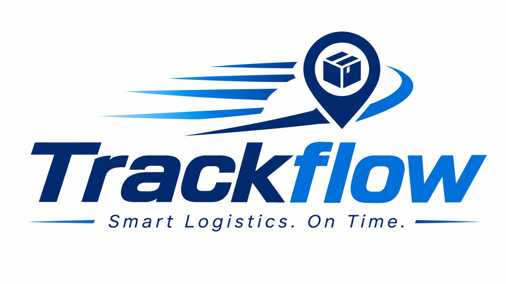

# 🖼️ Quick Alt Text Reference - TrackFlow

## ⚡ TL;DR - Lo Esencial

### ¿Qué Cambió?
- **Alt text mejorado**: De 42 a 148 caracteres
- **Estructura HTML**: De `<div>` a `<figure>` + `<figcaption>`
- **Atributos**: Agregadas dimensiones `width="600" height="400"`

### ¿Dónde?
- Archivo: `/index.html`
- Líneas: 175-183 (Hero Section Image)

### ¿Por Qué?
- ✅ Accesibilidad WCAG 2.1 Level AA
- ✅ SEO mejorado (Google Images)
- ✅ Performance (evita layout shift)
- ✅ UX fallback cuando imagen no carga

---

## 🎯 Estructura de Alt Text

```
[MARCA] [DESCRIPTOR] [DETALLES] [CONTEXTO] [UBICACIÓN]
```

### Ejemplo Real - TrackFlow
```
TrackFlow modern warehouse facility with organized inventory 
management systems, logistics equipment, and professional 
warehouse staff coordinating e-commerce order fulfillment 
operations in Los Angeles
```

### Desdesglosado
- **MARCA**: TrackFlow
- **DESCRIPTOR**: modern warehouse facility
- **DETALLES**: organized inventory management systems, logistics equipment
- **CONTEXTO**: professional warehouse staff coordinating e-commerce order fulfillment
- **UBICACIÓN**: in Los Angeles

---

## 📝 HTML Correcto

### Estructura Completa
```html
<figure class="rounded-lg overflow-hidden shadow-xl">
    
    <figcaption class="sr-only">
        TrackFlow warehouse operations showcasing professional logistics infrastructure for e-commerce fulfillment
    </figcaption>
</figure>
```

### Elementos Clave

| Elemento | Propósito | Obligatorio |
|----------|-----------|------------|
| `<figure>` | Agrupa imagen + descripción | ✅ |
| `` | Describe contenido | ✅ |
| `<figcaption>` | Leyenda oculta para SR | ✅ Para accessibility |
| `width/height` | Evita layout shift | ✅ |
| `loading="lazy"` | Performance | ✅ |
| `class="sr-only"` | Oculta visualmente | ✅ Para figcaption |

---

## ✅ Checklist Rápido

Antes de agregar una imagen:

- [ ] Alt text: 100-150 caracteres
- [ ] Alt text: Incluye qué, dónde, por qué
- [ ] Usa estructura `<figure>`
- [ ] Usa `<figcaption class="sr-only">`
- [ ] Especifica `width` y `height`
- [ ] Usa `loading="lazy"`
- [ ] Sin "imagen de" o "foto de"
- [ ] Sin keyword stuffing
- [ ] Lenguaje natural y legible

---

## 🚀 Copy-Paste Template

```html
<figure class="rounded-lg overflow-hidden shadow-xl">
    
    <figcaption class="sr-only">
        TrackFlow [descripción breve para lectores de pantalla]
    </figcaption>
</figure>
```

---

## 💡 Ejemplos Por Tipo

### Almacén
```
alt="TrackFlow [CIUDAD] warehouse facility showcasing organized 
    inventory management with professional logistics staff handling 
    e-commerce order fulfillment operations in [PAÍS]"
```

### Equipo de Entrega
```
alt="TrackFlow last-mile delivery team coordinating package 
    distribution with certified carriers including [CARRIERS] 
    for [REGIÓN] coverage"
```

### Logística Inversa
```
alt="TrackFlow reverse logistics process showing returned product 
    inspection, quality assessment, and reacondicionamiento 
    workflow for e-commerce brand returns management"
```

### Mapa
```
alt="TrackFlow operational coverage map displaying warehouse 
    locations in [CIUDAD1] [PAÍS1] and [CIUDAD2] [PAÍS2] with 
    national delivery networks"
```

---

## 🧪 Cómo Verificar

### En el Navegador
1. Clic derecho en imagen
2. Selecciona "Inspect" (F12)
3. Verifica que `alt="..."` está presente y es descriptivo

### Lectores de Pantalla
- Instala NVDA (Windows) o VoiceOver (Mac)
- Navega a la imagen
- Deberías escuchar la descripción completa del alt

### Google Chrome
1. Abre DevTools (F12)
2. Ve a "Lighthouse"
3. Ejecuta auditoría de accesibilidad
4. Busca "Image elements have alt attributes"

---

## 📚 Referencias

- **WCAG 2.1**: https://www.w3.org/WAI/WCAG21/
- **MDN Alt Text**: https://developer.mozilla.org/en-US/docs/Web/HTML/Element/img
- **WebAIM**: https://webaim.org/articles/alttext/
- **WAVE Tool**: https://wave.webaim.org/

---

## ❌ NO HAGAS ESTO

```html
<!-- ❌ MALO: Alt text genérico -->


<!-- ❌ MALO: Sin estructura figure -->
<div>
    
</div>

<!-- ❌ MALO: Alt text muy corto -->


<!-- ❌ MALO: Keyword stuffing -->


<!-- ❌ MALO: Sin dimensiones -->


<!-- ❌ MALO: "Imagen de" redundante -->

```

---

## ✅ HAZLO BIEN

```html
<!-- ✅ BIEN: Estructura correcta -->
<figure class="rounded-lg overflow-hidden shadow-xl">
    
    <figcaption class="sr-only">
        Professional warehouse operations for e-commerce fulfillment
    </figcaption>
</figure>
```

---

## 🎯 Métrica de Calidad - Tu Alt Text Debe Cumplir

| Métrica | Mínimo | Óptimo | Máximo |
|---------|--------|--------|--------|
| Caracteres | 80 | 100-150 | 180 |
| Palabras | 10 | 20-35 | 50 |
| Contexto (qué) | ✅ | ✅ | ✅ |
| Contexto (dónde) | - | ✅ | ✅ |
| Contexto (acción) | - | ✅ | ✅ |
| Elementos visuales | - | ✅ | ✅ |

---

## 🔍 Palabras Clave por Tipo

### Warehouse
- organized, management, systems
- professional staff, operations
- inventory, picking, packing
- fulfillment, e-commerce

### Delivery
- last-mile, distribution
- carriers, network, coverage
- nationwide, regional, cities
- shipping, logistics

### Reverse Logistics
- returns, inspection, assessment
- reacondicionamiento, repackaging
- quality control, management
- refund, exchange

---

## 💬 Soporte Rápido

**Pregunta**: "¿Cuán largo debe ser el alt text?"
**Respuesta**: 100-150 caracteres es óptimo. Si necesitas más, divide en alt + figcaption.

**Pregunta**: "¿Puedo dejar alt vacío?"
**Respuesta**: Solo si es decorativa. Si es informativa, SIEMPRE necesita alt descriptivo.

**Pregunta**: "¿Incluyo keywords SEO?"
**Respuesta**: Sí, pero naturalmente. "TrackFlow warehouse" ✅ vs "warehouse warehouse warehouse" ❌

**Pregunta**: "¿Funciona en mobile?"
**Respuesta**: Sí. Figcaption está oculto visualmente pero accesible para lectores de pantalla.

---

## 📞 ¿Necesitas Más?

Consulta `/ALT-TEXT-BEST-PRACTICES.md` para documentación completa con:
- Explicación detallada
- Patrones avanzados
- Herramientas de verificación
- Estándares WCAG
- Casos de uso específicos

---

**Última actualización**: 14 Nov 2026  
**Versión**: 1.2.1  
**Status**: ✅ LISTO PARA USAR
